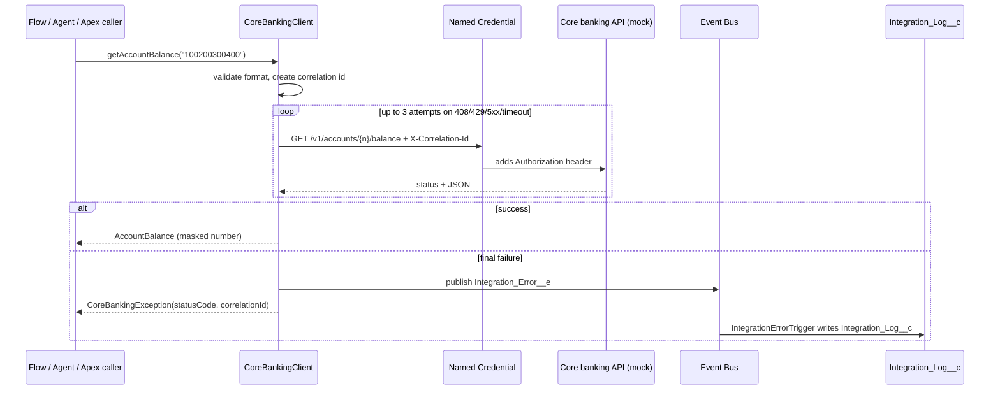

# Salesforce Core Banking Integration Pattern

[](https://github.com/khajamohsin0741-hash/sf-core-banking-integration/actions/workflows/ci.yml)
   

A reusable Apex pattern for calling an external banking REST API from Salesforce safely: Named Credentials instead of hard-coded secrets, retries for transient failures, correlation IDs for tracing, Platform Event error reporting, and masked account numbers. Includes a Dockerized mock API so the whole flow can be run without access to a real bank system.

> **Portfolio project.** Independently written, clean-room demonstration with synthetic data. It is not code from, or a copy of, any employer or client system, and the mock API is not modeled on any real vendor's API.
>
> Built with AI-assisted development and reviewed by the author.

## Business problem

Advisors and service agents need live data from core banking (balances, holds, transactions) inside Salesforce. Those systems time out, throttle, and go down for maintenance. Integrations that fail silently, leak account numbers into logs, or store credentials in code create both service and compliance problems.

## What it demonstrates

| Concern | Implementation |
| --- | --- |
| No secrets in code | `callout:Core_Banking_API` Named Credential + External Credential |
| Transient failure handling | Up to 3 attempts on timeouts, 408, 429 and 5xx; no retry on other 4xx |
| Traceability | One `X-Correlation-Id` per logical call, reused across retries and echoed by the API |
| Failure visibility | `Integration_Error__e` Platform Event (publish immediately), stored as `Integration_Log__c` by a subscriber trigger for reports and alerts |
| Data minimization | Account numbers validated before the call and masked (`****0400`) in results; bodies never logged |
| Low-code reuse | `GetAccountBalanceAction` invocable method for Flow or an Agentforce agent action |
| Testability | `CoreBankingMock` returns queued responses or throws `CalloutException` |
| API contract | OpenAPI 3 spec (`mock-core-banking-api/openapi.yaml`), linted in CI, with contract tests against the running server |
| Local end-to-end testing | Node.js mock API (no dependencies) with Dockerfile, Docker Compose and tests |

## Architecture



## Run the mock API

```bash
cd mock-core-banking-api
cp .env.example .env        # set MOCK_API_TOKEN to your own random value
docker compose up --build        # or: docker build -t mock-core-banking-api . && docker run --rm -p 8080:8080 --env-file .env mock-core-banking-api
curl -H "Authorization: Bearer <your token>" http://localhost:8080/v1/accounts/100200300400/balance
```

The API contract is in [`openapi.yaml`](mock-core-banking-api/openapi.yaml); paste it into any OpenAPI viewer, or import it into Postman to get a ready-made collection.

Without Docker: `MOCK_API_TOKEN=<token> node mock-core-banking-api/server.mjs` (Node.js 20+). Add `?simulate=503` to any request, or set `FAILURE_RATE=0.5`, to watch the client retry.

## Connect Salesforce to the mock API

Salesforce must reach the API over public HTTPS, so expose the local container with a tunnel of your choice, then in Setup:

1. **External Credential** `Core_Banking_API_Credential`, authentication protocol *Custom*, with a principal that stores the header `Authorization: Bearer <your token>`.
2. **Named Credential** `Core_Banking_API`, URL = your tunnel's HTTPS address, linked to that External Credential; "Generate Authorization Header" off.
3. Give users access to the External Credential principal and assign the `Core_Banking_Integration` permission set.

Then in Anonymous Apex:

```apex
System.debug(new CoreBankingClient().getAccountBalance('100200300400'));
```

## Deploy and test

```bash
sf org create scratch --definition-file config/project-scratch-def.json --alias banking --set-default
sf project deploy start
sf org assign permset --name Core_Banking_Integration
sf apex run test --test-level RunLocalTests --code-coverage --result-format human --wait 20

npm run test:pure    # mock API + OpenAPI contract tests, plain Node.js, no org needed
```

Apex tests use `HttpCalloutMock`, so they do not need the Named Credential to exist. In GitHub Actions they run when the `DEVHUB_SFDX_AUTH_URL` secret is set; the Docker image is built and smoke-tested on every push.

## Tests

| Suite | Tests | Covers |
| --- | --- | --- |
| `CoreBankingClientTest` | 8 | Parsing and masking, retry on 5xx and timeouts, no retry on 4xx, max attempts, input validation, bad JSON |
| `GetAccountBalanceActionTest` | 2 | Flow/agent action success and friendly errors |
| `IntegrationErrorLoggerTest` | 3 | Event to log record, end-to-end failed callout to log |
| Node (`npm run test:pure`) | 12 | Mock API auth, routes, masking in logs, failure simulation, OpenAPI contract |

## Security notes

* The bearer token lives only in the External Credential (Salesforce) and in an untracked `.env` file (mock API). `.env` is git-ignored; `.env.example` holds a placeholder.
* The mock API compares tokens in constant time, logs masked paths only, and runs as the non-root `node` user in the container.
* `CoreBankingClient` runs `with sharing`; callers need the permission set to publish error events.

## Limitations and next steps

* Apex cannot sleep, so retries are immediate. For longer outages, move retries to a self-chaining Queueable with backoff, or to middleware (for example MuleSoft) with a circuit breaker.
* Add a Flow on `Integration_Log__c` that alerts the integration owner when failures spike.
* Add a response cache (Platform Cache) for read-heavy balance lookups.

## License

MIT. See [LICENSE](LICENSE).
